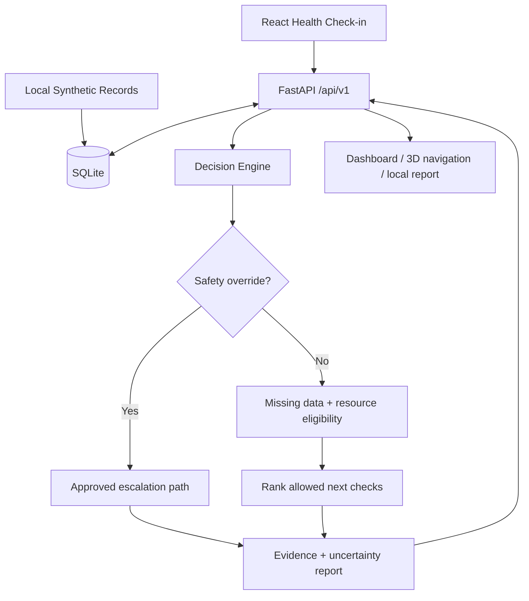

# MEDNAV — Technical Architecture

## Stack

- **UI:** React + Vite + TypeScript; Recharts for time series; React Three Fiber (optional 3D navigation).
- **API:** FastAPI with Pydantic validation and `/api/v1/` version prefix.
- **Local persistence:** SQLite for fictional astronaut profiles, check-ins, inventory, incidents and source provenance.
- **Decision engine:** a pure, deterministic Python module called by FastAPI; no network calls.
- **Tests:** pytest + optional Vitest; all scenarios use synthetic, seeded records.
- **Offline deployment:** all required assets bundled locally; local HTTP service; no remote API calls for core flow.

## Data flow



## Separation of responsibility

- Frontend transforms structured API responses into accessible UI. It **does not** make independent medical recommendations.
- Backend validates input, stores local records, calls decision engine, and returns structured outputs.
- Engine checks explicit safety flags, distinguishes unknown data, filters available resources, ranks only allowed check definitions and produces explainable evidence.
- Data/research maintains seed cases, evidence/source catalog and evaluation datasets; does not claim synthetic data is NASA crew telemetry.

## Suggested repository structure

```text
frontend/
  src/pages/      # dashboard, incident view
  src/components/ # health cards, charts, evidence panel
  src/three/      # optional 3D body selector
  src/lib/api.ts  # API typed client
backend/
  app/main.py
  app/routers/    # astronauts, checkins, inventory, investigations, reports
  app/models/     # Pydantic and DB models
  app/db/         # SQLite persistence and seed loading
engine/
  models.py
  rules.py
  next_check.py
  evidence.py
contracts/
  README.md       # live schema decisions recorded here
  examples/       # JSON fixtures, checked in alongside code
  data_sources.json
  tests/
data/
  synthetic/      # fictional crew and inventory
  sources/        # NASA source metadata/reference records
  scenarios/      # pre-labeled outcomes
  reports/        # generated local demo reports (gitignored if large)
tests/
  integration/
docs/
  evaluation.md
  demo_script.md
```

## Practical offline behavior

- The browser and API run locally on the demo laptop (`localhost`).
- Seed fixture files and 3D assets remain in the repository; internet disabled tests must pass.
- Reports are saved locally. A "pending sync" indicator may be shown, but **do not claim a completed Earth sync** without a working external channel.
- Optional voice controls must have clickable alternatives and confirmation for data changes.

## Integration interfaces

Member 2 owns API implementation and contract freeze. Member 3 supplies a Python entry point such as `evaluate_investigation(request: InvestigationRequest) -> InvestigationResponse`. Member 1 uses only API types. Member 4 supplies versioned fixture JSON/CSV and expected behavior tests.
